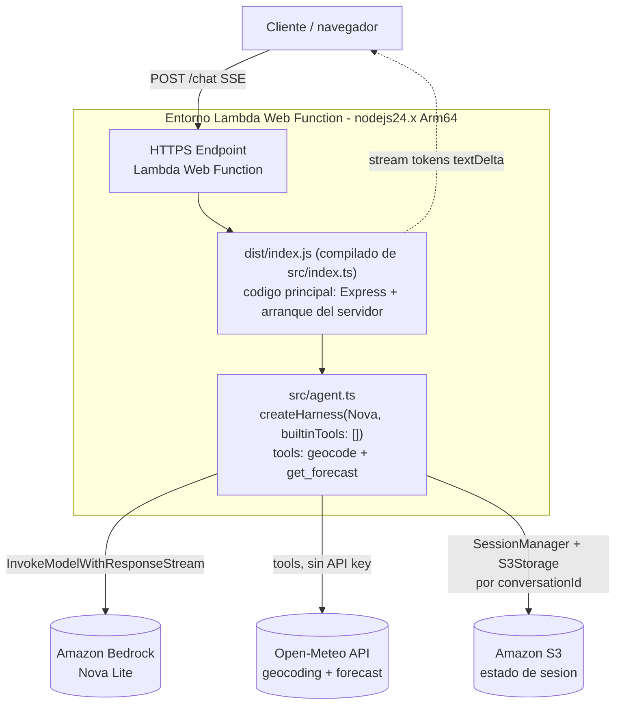

# agent-weather-sse

Agente de clima construido con el *harness* de Strands y servido vía SSE
(Server-Sent Events) desde una AWS Lambda Web Function. El agente responde
preguntas sobre el clima y ayuda a planificar viajes usando las APIs públicas
de Open-Meteo.

## Requisitos

- **AWS CLI v2 reciente**, en una versión que incluya los comandos `aws lambda-web`
  (Web Functions es un lanzamiento nuevo). Verificá con `aws lambda-web help`; si
  falla, actualizá: <https://docs.aws.amazon.com/cli/latest/userguide/getting-started-install.html>
- **Solo si vas a desplegar con SAM**: AWS SAM CLI en su **última versión** (las
  anteriores no conocen el recurso `AWS::Serverless::WebFunction`). Instalá o
  actualizá desde: <https://docs.aws.amazon.com/serverless-application-model/latest/developerguide/install-sam-cli.html>
- Credenciales AWS configuradas (`aws configure`, SSO o variables de entorno) y
  Node.js 22+ para compilar.
- Los comandos estan en git bash

## 1. Lambda Web Functions con Express

Actua de servidor HTTP normal de Express desplegado como **Lambda Web Function**.
A diferencia de una Lambda clásica basada en eventos, una Web Function recibe
peticiones HTTP directas: el código es un servidor web común, sin adaptadores
ni API Gateway de por medio. Esto nos permite:

- Reutilizar Express tal cual, con rutas y middleware estándar (entre otros).
- Modelar la concurrencia **por entorno de ejecución** (cada instancia atiende
  peticiones mientras está viva), igual que un servidor tradicional.
- Hacer *streaming* de tokens al cliente con **SSE**, para que la respuesta del
  agente aparezca progresivamente en vez de esperar al final.

### Arquitectura



El **código principal de la Lambda es `src/index.ts`** (se compila a
`dist/index.js`, que es lo que ejecuta la función): contiene toda la API de
Express (rutas `/chat` y `/health`) y el arranque del servidor. Delega en
`src/agent.ts`, que arma el agente de Strands, y en `src/config.ts`
(variables de entorno) y `src/tools/` (las dos herramientas de Open-Meteo).

El `app.listen` solo se ejecuta cuando `index.js` corre como **entrypoint**, no
cuando se importa; así los tests pueden usar la app sin abrir un puerto.

## 2. Por qué el harness de Strands

Usamos el *harness* por defecto de Strands (`createHarness`): construye un agente robusto y preconfigurado (contrato de prompt, orquestación de herramientas y modelo listos para usar). Un objetivo secundario de este ejemplo es justamente
**practicar ese harness** en un caso realista.

### `builtinTools: []`

El harness trae herramientas integradas (shell, lectura/escritura de archivos,
`web_fetch`, `web_search`, etc.). Las deshabilitamos todas con
`builtinTools: []` por **mínimo privilegio**: un agente de clima público solo
necesita sus dos herramientas de dominio (`geocode` y `get_forecast`) y no tiene
por qué poder ejecutar comandos, tocar el sistema de archivos ni navegar la web.

## 3. El modelo Amazon Nova

El agente usa **Amazon Nova 2 Lite** en Bedrock (por defecto
`us.amazon.nova-2-lite-v1:0`), un modelo reciente, rápido y de bajo costo con
razonamiento. Puntos clave:

- Es el modelo propio de Amazon en Bedrock; la inferencia se factura a tus
  **créditos de AWS Bedrock**.
- Hay que **habilitar el acceso al modelo** en la región elegida (`AWS_REGION`).
- Se pasa **explícito** a `createHarness` (`model: ...`) porque el default del
  harness es Claude.
- El prefijo `us.` indica un *inference profile* cross-region: la política IAM
  debe permitir tanto el *inference profile* como el *foundation-model* destino.

## 4. Sesiones en S3

Para que la conversación persista entre invocaciones (la Lambda es *stateless* y
su sistema de archivos es efímero) guardamos las sesiones en **S3**:

- **No** usamos la opción de sesión por archivo del harness, porque es
  solo-sistema-de-archivos y no sirve en el disco efímero de Lambda.
- Cableamos la persistencia por *passthrough* del SDK: un `SessionManager`
  (de `@strands-agents/sdk`) con `sessionId: conversationId`, apoyado en
  `S3Storage` (de `@strands-agents/sdk/storage`) apuntando a `SESSION_BUCKET`
  con el prefijo `SESSION_PREFIX`.
- La persistencia ocurre por **hooks del ciclo de vida** del agente: no es una
  herramienta y **no depende de `write`/`edit`** (que de hecho están
  deshabilitadas). Por eso guardar en S3 funciona aun con `builtinTools: []`.

Cada conversación se identifica por `conversationId`, que es la clave de la
sesión.

### Backend de sesión según el entorno

El `SessionManager` admite distintos backends de `Storage`. El código elige uno
u otro según `SESSION_BUCKET`:

- **Con `SESSION_BUCKET`** → `S3Storage`. Es el correcto para Lambda Web
  Functions, cuyo filesystem es efímero y sin afinidad de sesión.
- **Sin `SESSION_BUCKET`** → `LocalFileStorage` en `SESSION_DIR` (por defecto
  `.sessions/`). Es un *fallback* **solo para desarrollo local**: te deja probar
  el agente sin crear un bucket. En la nube no sirve, porque el disco es
  efímero.


## 5. Tools (Open-Meteo)

El agente registra dos herramientas de dominio, ambas contra Open-Meteo y
**sin API key**:

- `geocode`: convierte un nombre de ciudad en coordenadas (lat/lon) y país.
- `get_forecast`: devuelve un pronóstico diario compacto para una lat/lon.

El prompt obliga el orden `geocode` -> `get_forecast`: primero resuelve
coordenadas, nunca las adivina.

## 6. Routes

- `POST /chat` — recibe `{ "conversationId": string, "message": string }` y
  responde por **SSE**: un frame `data: {"token": "..."}` por cada fragmento de
  texto y un evento final `event: done`.
- `GET /health` — sonda de salud; responde `{"status":"healthy"}`.

> Nota: `/ping` está **reservado por la plataforma** de Lambda Web Functions y
> no llega a la aplicación; por eso la sonda de salud es `/health`, no `/ping`.

## 7. Concurrencia y buenas prácticas

El servidor es *stateless* a propósito: **no hay estado mutable por petición en
variables globales**. Todo el estado de conversación vive en S3, indexado por
`conversationId`. Así cualquier instancia de la Lambda Web Function puede atender
cualquier petición de forma segura.

## 8. Ejecución local

Instala dependencias y compila:

```bash
npm install
npm run build
```

Arranca el servidor en local. En local definís el
`host:port`; en la nube lo provee Lambda:


```bash
AWS_LAMBDA_HTTP_ENDPOINT=127.0.0.1:3000 node dist/index.js
# -> Server listening on 127.0.0.1:3000
```
### Pruebas manuales (servidor local)

Con el servidor arrancado (sección 8), la sonda de salud **no** requiere AWS:

```bash
curl http://127.0.0.1:3000/health

```

El chat con streaming **sí** requiere credenciales AWS con acceso al modelo
**Bedrock Nova** (el modelo es siempre un llamado a la nube, no se puede evitar
en local). En cambio, la **persistencia de sesión funciona sin S3**: si no
defines `SESSION_BUCKET`, el agente usa `LocalFileStorage` y guarda las
conversaciones en disco local (directorio `SESSION_DIR`, por defecto `.sessions/`).

Para probar `/chat` en local arranca el servidor con tus credenciales
y región (git bash); sin `SESSION_BUCKET` las sesiones van a `.sessions/`:

```bash
AWS_LAMBDA_HTTP_ENDPOINT=127.0.0.1:3000 \
AWS_REGION=us-east-1 \
node dist/index.js
```

El flag `-N` desactiva el buffer de curl para ver los tokens llegar por SSE:

```bash
curl -N -X POST http://127.0.0.1:3000/chat \
  -H "Content-Type: application/json" \
  -d '{"conversationId":"demo-1","message":"¿Qué tiempo hará en Buenos Aires esta semana?"}'
# -> data: {"token":"..."}  (varios frames)
# -> event: done
```


## 9 Tests automáticos

```bash
npm test
```

Son tests de `node:test` que no llaman a Bedrock ni a S3: cubren el parseo de
config, las dos herramientas de Open-Meteo (con `fetch` simulado) y las rutas
HTTP (`GET /health` responde 200, y `POST /chat` responde 400 si falta
`conversationId` o `message`). Importan la app con `createApp()` sin abrir un
puerto.


## 10. Build y despliegue en AWS (paso a paso)

El despliegue usa el CLI oficial `aws lambda-web deploy` (AWS CLI v2 reciente;
verifica con `aws lambda-web help`). **No necesitas poner credenciales en el
proyecto**: el CLI usa el login que ya tenés configurado en tu máquina
(`aws configure`, SSO o variables de entorno).
https://docs.aws.amazon.com/cli/latest/userguide/getting-started-install.html

Para simplificar, **dejamos que el CLI cree y gestione el bucket de código** (lo
crea con *versioning* y los permisos correctos). Así solo creas a mano el
**bucket de sesiones** (`SESSION_BUCKET`), que el agente usa en runtime para
persistir conversaciones. El único valor que vas a reemplazar en varios lados es
el **nombre de tu bucket de sesiones**, que debe ser único.

Todos los comandos van en **bash / git bash**, ejecutados **desde la raíz del
subproyecto** (`agent-weather-sse/`), porque usan rutas relativas (`file://...`).

### Paso 1 — Compilar

```bash
npm install
npm run build
```

### Paso 2 — Crear el bucket de sesiones

Reemplaza `mi-bucket-de-sesiones` por un nombre único:

```bash
aws s3 mb s3://mi-bucket-de-sesiones --region us-east-1
```

### Paso 3 — Crear el rol de ejecución

El repo ya trae `trust-policy.json` (deja que Lambda asuma el rol) y
`iam/execution-role-policy.json` (permisos de Bedrock y S3). La política de
permisos usa `*` en región y cuenta.
**Lo único que tenés que editar es el nombre del bucket de sesiones**: abrí `iam/execution-role-policy.json` y reemplazá `<SESSION_BUCKET>` por `mi-bucket-de-sesiones` (aparece dos veces).


```bash
aws iam create-role \
  --role-name weather-agent-execution-role \
  --assume-role-policy-document file://trust-policy.json

aws iam attach-role-policy \
  --role-name weather-agent-execution-role \
  --policy-arn arn:aws:iam::aws:policy/service-role/AWSLambdaBasicExecutionRole

aws iam put-role-policy \
  --role-name weather-agent-execution-role \
  --policy-name weather-agent-bedrock-s3 \
  --policy-document file://iam/execution-role-policy.json
```

Guarda el ARN del rol en una variable para el paso siguiente:

```bash
ROLE_ARN=$(aws iam get-role --role-name weather-agent-execution-role \
  --query 'Role.Arn' --output text)
```

### Paso 4 — Desplegar

Omitimos `--bucket-name`: el CLI crea el bucket de código por su cuenta. El flag
`--create` confirma sin prompt:

```bash
aws lambda-web deploy \
  --name weather-agent \
  --code . \
  --execution-role-arn "$ROLE_ARN" \
  --entry-point dist/index.js \
  --env BEDROCK_MODEL_ID=us.amazon.nova-2-lite-v1:0 \
  --env SESSION_BUCKET=mi-bucket-de-sesiones \
  --env SESSION_PREFIX=weather-agent/ \
  --create

```

El endpoint por defecto se llama `dev` y usa autenticación *application-managed*
(pública); para exigir firma SigV4 añade `--auth-type IamAuth`.

Verificar si se creo `aws lambda-web list-web-functions`

**Si queres volver a deployar** para cambiar alguna variable de entorno
IMPORTANTE!! reemplazar "mi-bucket-de-sesiones" por el nombre de tu bucket de sessiones:

```bash
npm run build

aws lambda-web deploy \
  --name weather-agent \
  --code . \
  --entry-point dist/index.js \
  --env SESSION_BUCKET=mi-bucket-de-sesiones \
  --env BEDROCK_MODEL_ID=us.amazon.nova-2-lite-v1:0 \
  --env SESSION_PREFIX=weather-agent/
```

### Paso 5 — Verificar las variables de entorno de la función

Se configuran en la propia función como lo vimos anteriormente (no con el `.env`, que es solo para local):
`AWS_REGION`, `BEDROCK_MODEL_ID`, `SESSION_BUCKET=mi-bucket-de-sesiones`,
`SESSION_PREFIX` y `AWS_LAMBDA_NODEJS_ENTRYPOINT=dist/index.js` (necesario porque
compilamos a `dist/` y el entrypoint por defecto es `index.js` en la raíz).

Se puede verificar desde la consola de aws.

### Paso 6 — Probar

Al terminar, el comando devuelve la URL HTTPS del endpoint:
Obtener endpoint

```bash
aws lambda-web get-web-function-endpoint \
  --function-name weather-agent \
  --endpoint-name dev \
  --query 'domainName' --output text

```
Salud del endpoint (reemplazar <endpoint> por el valor obtenido):

```bash
curl https://<endpoint>/health
# -> {"status":"healthy"}
```

Testar el chat con el Agente via curl (reemplazar <endpoint> por el valor obtenido):

```bash
curl --ssl-no-revoke -N -X POST \
  <endpoint>/chat \
  -H "Content-Type: application/json" \
  -d '{"conversationId":"demo-1","message":"¿Qué pronostico del tiempo hará en Matheu-Escobar Buenos Aires esta semana?"}'
```

En **Postman**:

- Método: **POST**
- URL: `https://<endpoint>/chat`
- Body → **raw → JSON**: `{"conversationId":"demo-1","message":"tu prompt"}`
- Header: `Content-Type: application/json`

Postman soporta SSE: vas a ver los `data: {"token":...}` llegando en vivo (si no, igual te muestra la respuesta completa al cerrar el stream). 
El `/health` lo probás con un GET simple.

Nota: Nova devuelve "chunks" de texto de tamaño arbitrario (a veces una palabra, a veces media, a veces varias), no palabra por palabra. Tu /chat reenvía cada chunk tal cual llega como un frame SSE. Si quisieras entregar palabras completas, tendrías que bufferear hasta un espacio antes de emitir. Pero se deja de esta manera para visualizar el streaming y la entrega de la web function.

### Troubleshooting

Mirar los logs:
```bash
MSYS_NO_PATHCONV=1 aws logs tail "/aws/lambda/web/weather-agent.local" --since 15m

```

Hacer curl sin chequear revocacion :
```bash
curl --ssl-no-revoke https://xxxxxxx.lambda-web.us-east-1.on.aws/health
```

## Despligue en AWS via SAM (IaC)

También puedes desplegar con `AWS::Serverless::WebFunction` (requiere SAM CLI en su última versión, ver Requisitos). 
El paso a paso está en [`sam/README.md`](sam/README.md).

> Para `WebFunction`, SAM **no empaqueta código local**: `CodeUri` debe ser un
> **objeto en S3**. El flujo es: compilar (`npm run build`) → `zip` del artefacto
> → subir a un bucket con *versioning* → tomar el *version id* → pasar
> `CodeBucket`/`CodeKey`/`CodeVersion` al `sam deploy`.

## 11. 🧹 Limpieza del ambiente (IMPORTANTE!)

Eliminar todos los recursos desplegados para no generar gastos. **Un solo comando no limpia todo**: `delete-web-function` elimina la función, sus *endpoints* y revisiones, pero **no** borra el rol de ejecución, el bucket de código ni los *log groups*.


```bash
aws lambda-web delete-web-function --function-name weather-agent
```

Luego borra el resto a mano, solo si no lo compartes con otros despliegues:

- **Bucket de código** (los paquetes `.zip`, incluidas versiones antiguas). Si   usaste uno por defecto del CLI, su prefijo es `lambda-web/weather-agent/`.
- **Bucket de sesiones** (`SESSION_BUCKET`): vacíalo y bórralo.
- **Rol de ejecución** (si lo creó el CLI, por defecto
  `awscli-lambdaweb-weather-agent`).
- **Log groups** de CloudWatch de la función.

El bucket de **sesiones** no tiene versioning, así que alcanza con vaciar y borrar:

```bash
aws s3 rm s3://<SESSION_BUCKET> --recursive && aws s3 rb s3://<SESSION_BUCKET>
```

El bucket de **código** tiene versioning (obligatorio para WebFunction), así que `aws s3 rm --recursive` no alcanza: hay que borrar todas las versiones y los *delete markers* antes de eliminarlo:

```bash
CODE_BUCKET=<BUCKET_CODIGO>

aws s3api delete-objects --bucket "$CODE_BUCKET" \
  --delete "$(aws s3api list-object-versions --bucket "$CODE_BUCKET" \
    --query '{Objects: Versions[].{Key:Key,VersionId:VersionId}}' --output json)"

# Delete markers (ignorá el error si no hay ninguno)
aws s3api delete-objects --bucket "$CODE_BUCKET" \
  --delete "$(aws s3api list-object-versions --bucket "$CODE_BUCKET" \
    --query '{Objects: DeleteMarkers[].{Key:Key,VersionId:VersionId}}' --output json)"

aws s3 rb "s3://$CODE_BUCKET"
```

Borra el rol de ejecución. Un rol no se puede borrar si tiene políticas, así que
primero quitá la política administrada, luego la inline, y recién después el rol:

```bash
# 1. Desadjuntar la política administrada (logs de CloudWatch)
aws iam detach-role-policy \
  --role-name weather-agent-execution-role \
  --policy-arn arn:aws:iam::aws:policy/service-role/AWSLambdaBasicExecutionRole

# 2. Borrar la política inline (Bedrock + S3)
aws iam delete-role-policy \
  --role-name weather-agent-execution-role \
  --policy-name weather-agent-bedrock-s3

# 3. Borrar el rol
aws iam delete-role --role-name weather-agent-execution-role
```

Borra los *log groups* de CloudWatch (la función tiene dos: el centralizado y su `.local`):

```bash
MSYS_NO_PATHCONV=1 aws logs delete-log-group --log-group-name "/aws/lambda/web/weather-agent"
MSYS_NO_PATHCONV=1 aws logs delete-log-group --log-group-name "/aws/lambda/web/weather-agent.local"
```

> El bucket de código por defecto puede estar compartido por otros despliegues
> de la misma cuenta y región; no lo borres si tienes otras Web Functions.

## 12. IAM

El archivo `iam/execution-role-policy.json` es una política de **mínimo
privilegio** de ejemplo para el rol de ejecución. Antes de usarla reemplaza los
placeholders:

- `<region>` — tu región de AWS (debe coincidir con `AWS_REGION`).
- `<account-id>` — tu ID de cuenta de AWS (12 dígitos).
- `<SESSION_BUCKET>` — el nombre real del bucket de `SESSION_BUCKET`.

Concede exactamente `bedrock:InvokeModel` e
`bedrock:InvokeModelWithResponseStream` sobre el modelo Nova (ARN del modelo
base y del *inference profile* cross-region) y las acciones S3
`s3:PutObject`, `s3:GetObject`, `s3:DeleteObject` sobre los objetos del bucket
más `s3:ListBucket` sobre el bucket.

## 13. Variables de entorno

| Variable | Requerida | Default | Descripción |
| --- | --- | --- | --- |
| `AWS_REGION` | No | `us-east-1` | Región de AWS para Bedrock y S3. |
| `BEDROCK_MODEL_ID` | No | `us.amazon.nova-2-lite-v1:0` | Modelo Bedrock (Amazon Nova 2 Lite). |
| `SESSION_BUCKET` | En la nube | — | Bucket S3 para sesiones. Sin él, usa `LocalFileStorage` (solo local). |
| `SESSION_PREFIX` | No | `weather-agent/` | Prefijo de claves de las sesiones en S3. |
| `SESSION_DIR` | No | `./.sessions/` | Carpeta local para sesiones cuando no hay `SESSION_BUCKET`. |
| `AWS_LAMBDA_HTTP_ENDPOINT` | Runtime | `127.0.0.1:3000` | `host:port` del servidor; lo provee Lambda, en local lo defines tú. |

## 14. Costo del laboratorio

Correr este laboratorio para probar y escribir el artículo (unas decenas o
pocos cientos de peticiones, no tráfico de producción) tiene un costo
**muy bajo, prácticamente nulo**. Desglose por servicio:

| Servicio | Qué se cobra | En este laboratorio |
| --- | --- | --- |
| **Lambda Web Functions** | Peticiones + **CPU activa** (vCPU-segundo) + memoria por vida del entorno | Centavos o cubierto por capa gratuita |
| **Amazon Bedrock (Nova 2 Lite)** | Tokens de entrada y salida | El gasto dominante, aun así bajo |
| **Amazon S3** | Almacenamiento + peticiones PUT/GET | Despreciable (sesiones son KB) |
| **Open-Meteo** | — | Gratis, sin API key |


### Estimación rápida (laboratorio típico)

Para ~200 peticiones de prueba con conversaciones cortas: Lambda y S3 quedan
dentro de la capa gratuita o en centavos, y Bedrock Nova 2 Lite ronda **menos
de 1 USD** en total. El gasto real depende del número de pruebas y, sobre todo,
del tamaño de los prompts y respuestas.

> **Verifica los números antes de publicarlos.** Las tarifas exactas de la CPU
> activa de Lambda Web Functions y de Nova 2 Lite por millón de tokens cambian y
> dependen de la región. Consulta las páginas oficiales de
> [precios de AWS Lambda](https://aws.amazon.com/lambda/pricing/),
> [precios de Amazon Nova](https://aws.amazon.com/nova/pricing/) y
> [precios de Amazon S3](https://aws.amazon.com/s3/pricing/), y mide tu propio
> consumo en la factura o en Cost Explorer. Las cifras de arriba son órdenes de
> magnitud para un laboratorio, no una cotización.


